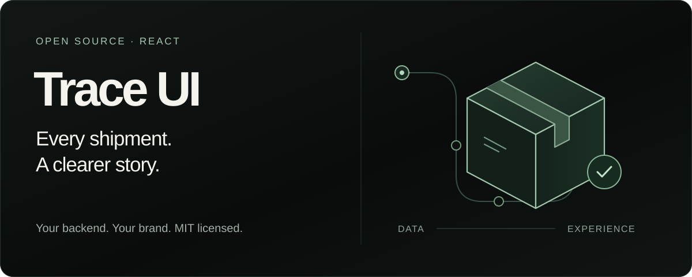
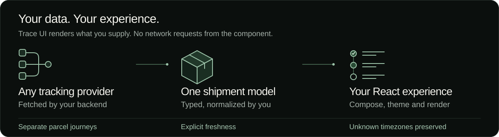

[](https://traceapi.dev/timeline-builder?utm_source=github&utm_medium=readme&utm_campaign=trace-ui-readme)

# Trace UI

**Beautiful shipment experiences. Your data. Your brand.**

An open-source React toolkit for shipment timelines, multi-parcel orders and return journeys. Start with local samples, make the interface your own, then connect the tracking backend you already use.

**MIT licensed · React 18.2 / 19 · TypeScript · Server rendering · Plain CSS**

[Try the visual builder](https://traceapi.dev/timeline-builder?utm_source=github&utm_medium=readme&utm_campaign=trace-ui-readme) · [Quick start](#add-it-to-your-app) · [Component reference](packages/timeline/README.md) · [Next.js starter](examples/nextjs-tracking/README.md) · [Release notes](CHANGELOG.md)

---

## Start where you are

| You want to… | Start here |
| --- | --- |
| Explore the design without installing anything | [Open the free timeline builder](https://traceapi.dev/timeline-builder?utm_source=github&utm_medium=readme&utm_campaign=trace-ui-readme) |
| Add tracking to an existing React app | [Install the component](#add-it-to-your-app) |
| Build a private order-tracking experience | [Run the Next.js starter](#run-the-nextjs-starter) |
| Display data from your current provider | [Map your data](#bring-your-own-data) |
| Use Trace as your tracking backend | [Connect Trace API](#connect-trace-api) |
| Debug a webhook receiver | [Run the local webhook doctor](#debug-webhooks-locally) |

## Made for the whole shipment journey

| Capability | What you can build |
| --- | --- |
| **Delivery progress and scan history** | A complete shipment view, or a custom composition of smaller components. |
| **Multiple parcels** | One order with independent carriers, statuses and histories for every parcel. |
| **Exceptions, pickup and returns** | Explicit states and configurable progress stages for journeys beyond delivery. |
| **Honest tracking data** | Visible stale-data notices, unavailable states and unknown-timezone labels. |
| **Your visual language** | Dark and light themes, compact spacing, CSS tokens and customizable labels. |
| **International interfaces** | English, Spanish, French and Arabic dictionaries, RTL layout and date formatting. |
| **A working integration path** | A Next.js starter with customer-owned orders, a signed webhook receiver and durable processing. |

The React component makes **no network requests**, includes **no telemetry**, and requires **no account, API key or Trace branding**. The code is MIT licensed and usable in commercial projects.



## Add it to your app

Install the pinned **0.2.0** release in an app using React 18.2 or 19:

```sh
npm install @traceapi/timeline@0.2.0
```

Render a fictional shipment immediately:

```tsx
import { ShipmentTimeline } from '@traceapi/timeline';
import { sampleShipments } from '@traceapi/timeline/samples';
import '@traceapi/timeline/styles.css';

export default function TrackingView() {
  return (
    <ShipmentTimeline
      shipment={sampleShipments.in_transit}
      theme="dark"
      locale="en"
    />
  );
}
```

In **Next.js**, import the stylesheet once in your root `app/layout.tsx`. The components render in server or client components and have no Tailwind dependency. Your app owns data fetching and refresh behavior.

**Distribution:** install the component from [npm](https://www.npmjs.com/package/@traceapi/timeline), the TypeScript client from [npm](https://www.npmjs.com/package/@traceapi/sdk), and the Python client from [PyPI](https://pypi.org/project/traceapi-sdk/). The component is **0.2.0**; the optional API clients are **0.3.0**. Pin versions while these packages are in 0.x. Existing pinned downloads remain available.

## Bring your own data

Map your provider response to `TimelineShipment`. The UI depends on this small display model, so changing your backend does not require replacing the interface.

```tsx
import { ShipmentTimeline, type TimelineShipment } from '@traceapi/timeline';
import '@traceapi/timeline/styles.css';

// Fictional example. Map fields from evidence your provider actually supplies.
const shipment: TimelineShipment = {
  reference: 'Order #1042 · Parcel 1',
  carrier: 'Example carrier',
  status: 'in_transit',
  freshness: 'cached',
  eventOrder: 'newest_first',
  events: [
    {
      id: 'scan-2',
      description: 'Arrived at the sorting facility',
      location: 'Example hub',
      timestamp: null,
      localTime: '2026-03-17T19:35:00',
      timezone: 'unknown',
    },
    {
      id: 'scan-1',
      description: 'Shipment accepted',
      timestamp: '2026-03-17T09:00:00Z',
    },
  ],
};

export default function OrderShipment() {
  return <ShipmentTimeline shipment={shipment} theme="light" />;
}
```

The first scan stays a local time with an unknown-timezone label. The second is a verified instant and can be formatted in a chosen timezone. Event order stays exactly as supplied.

For untyped JSON, use `validateShipment`, `parseShipmentJson` or `validateTraceTracking` before rendering. Validation checks the data shape and flags unverified timestamps; it cannot establish whether a carrier's claim is true. See the [data rules and validation reference](packages/timeline/README.md#validate-untyped-json-and-adapt-trace).

## Make it your own

Change presentation with props and CSS variables. Here is a compact Spanish interface with a custom accent and rounded corners:

```tsx
import type { CSSProperties } from 'react';
import { ShipmentTimeline } from '@traceapi/timeline';
import { sampleShipments } from '@traceapi/timeline/samples';
import '@traceapi/timeline/styles.css';

export default function BrandedTracking() {
  return (
    <ShipmentTimeline
      shipment={sampleShipments.delivered}
      theme="light"
      density="compact"
      locale="es"
      timeZone="Europe/Madrid"
      messages={{ history: 'Movimientos', statuses: { delivered: 'Recibido' } }}
      style={{ '--tt-accent': '#285744', borderRadius: 12 } as CSSProperties}
    />
  );
}
```

| Option | Use it for |
| --- | --- |
| `theme="dark"` or `"light"` | Match your application's color scheme. |
| `density="compact"` | Reduce spacing for dashboards and support panels. |
| `layout="compact"` | Omit the progress path while keeping history and disclosures. |
| `locale`, `timeZone`, `messages` | Translate interface labels and format verified instants. |
| `direction="rtl"` | Set text direction explicitly; Arabic also selects RTL automatically. |
| `stages` | Define progress steps for a pickup or return journey. |
| `className`, `style` | Adjust styling and tokens such as `--tt-bg`, `--tt-text`, `--tt-border` and `--tt-accent`. |

Carrier descriptions remain in the language supplied by your provider. Dates with unknown timezones are never converted just because a display timezone is selected.

### Compose a smaller interface

Use `ShipmentTimeline` for the complete experience, or assemble the same primitives in your own layout:

```tsx
import {
  TimelineFrame, ShipmentSummary, FreshnessNotice,
  ExceptionNotice, ShipmentHistory, ShipmentFreshness,
} from '@traceapi/timeline';
import { sampleShipments } from '@traceapi/timeline/samples';
import '@traceapi/timeline/styles.css';

export default function SupportTimeline() {
  const options = { shipment: sampleShipments.in_transit, locale: 'en' };

  return (
    <TimelineFrame theme="dark" density="compact" locale="en" title="Shipment details">
      <ShipmentSummary {...options} />
      <FreshnessNotice {...options} />
      <ExceptionNotice {...options} />
      <ShipmentHistory {...options} />
      <ShipmentFreshness {...options} />
    </TimelineFrame>
  );
}
```

Add `ShipmentProgress` when your layout needs a progress path. Formatting options are explicit props: pass `locale`, `timeZone` and `messages` to the primitives that use them. The frame supplies the visual boundary, not implicit formatting context.

### Keep every parcel's journey separate

```tsx
import { OrderTracking, type TimelineOrder } from '@traceapi/timeline';
import { sampleShipments } from '@traceapi/timeline/samples';
import '@traceapi/timeline/styles.css';

const order: TimelineOrder = {
  reference: 'Order #1042',
  shipments: [
    { ...sampleShipments.delivered, reference: 'Parcel 1' },
    { ...sampleShipments.in_transit, reference: 'Parcel 2' },
  ],
};

export default function CustomerOrder() {
  return <OrderTracking order={order} theme="dark" locale="en" />;
}
```

One delivered parcel does not mark the other delivered. Each keeps its own status, freshness and scans. The component does not invent a shared ETA or an aggregate delivery percentage.

For ready-to-adapt layouts, see [OrderTrackingPage](templates/OrderTrackingPage.tsx), [SupportShipmentPanel](templates/SupportShipmentPanel.tsx) and [ReadOnlyReturnTimeline](templates/ReadOnlyReturnTimeline.tsx). These templates display existing data; they do not purchase labels, issue refunds or authorize access to an order.

## Handle the difficult states honestly

Tracking interfaces are most useful when something is delayed, uncertain or unavailable.

| Situation | Trace UI behavior |
| --- | --- |
| A cached response | Displays its supplied freshness; it does not pretend to be a new observation. |
| An older result after a failed refresh | `freshness: 'stale'` preserves the last-known journey with a visible warning. |
| No usable tracking result | `status: 'unknown'` displays unavailable information instead of inventing a pending shipment. |
| A local scan without a timezone | Shows `localTime` with an unknown-timezone label; no guessed UTC conversion. |
| A delivery estimate | Labels the supplied estimate; does not calculate or guarantee a delivery date. |
| Ambiguous event ordering | Preserves the supplied order; only highlights a latest event when supported by explicit ordering or comparable timestamps. |
| A return, pickup or cancellation | Uses its explicit status; does not infer normal delivery completion. |
| A provider-reported handoff | Displays the supplied carrier and `kind: 'handoff'`; does not infer a relationship between carriers. |

**Statuses:** `pending`, `in_transit`, `out_for_delivery`, `customs`, `delivered`, `exception`, `unknown`, `pickup_available`, `return_in_transit`, `returned`, `cancelled`.

**Freshness:** `live`, `cached`, `stale`, `simulated`, `unknown`. Set freshness using your backend's source and cache policy; the UI does not calculate it.

Semantic sections, ordered scan lists, textual states, verified `<time>` elements and current-step labels keep meaning independent of color. The component itself has no animations or required pointer interactions. [Read the full accessibility and localization notes](packages/timeline/README.md#localization-and-accessibility).

## Design in the visual builder

The [free timeline builder](https://traceapi.dev/timeline-builder?utm_source=github&utm_medium=readme&utm_campaign=trace-ui-readme) lets you explore the same component before integrating it:

1. **Choose a journey.** Preview a shipment or a split order, then explore delivery, exceptions, stale data, pickup, returns and more.
2. **Make it fit.** Change the theme, density, layout, language and progress path. Replay fictional scans to inspect how the experience changes.
3. **Bring it into your app.** Validate sanitized JSON and copy the generated React example with your chosen settings.

Builder JSON stays in page memory. It is not sent to a service, persisted or embedded in a share URL. The README artwork is a custom schematic illustration; the builder is where you can try the actual rendered component.

[Read the release walkthrough](https://traceapi.dev/blog/introducing-trace-ui?utm_source=github&utm_medium=readme&utm_campaign=trace-ui-readme) · [Use the demo guide](docs/launch-demo.md)

## Run the Next.js starter

### First, render the local demo

With **Node 22+** and npm:

```sh
git clone https://github.com/traceapi-dev/trace-ui.git
cd trace-ui
npm ci
npm run dev
```

Open **http://localhost:3000**. This demo renders local fixtures without an account, API key or database. The five-minute starting point is this first UI render; connecting identity, a database and live carrier data are separate steps.

### Then, try the durable order workflow

The optional private starter connects a customer-owned order to a persistent webhook inbox and a separate worker:

```text
Signed webhook
    │  verify original bytes
    ▼
Postgres inbox ── persist before acknowledging
    │  claim and process an accepted event
    ▼
Revisioned order projection
    │  tenant + authenticated customer ownership checks
    ▼
Private order page ── refresh saved data, without a carrier lookup
```

Follow the [complete starter guide](examples/nextjs-tracking/README.md) to copy its `.env.example` to `.env.local`, keep demo/fixture mode, and configure your own isolated local Postgres database. Then run these commands **inside `examples/nextjs-tracking`**:

```sh
npm run starter:setup
npm run fixture:seed
```

Keep the development server running from the repository root. Sign in at **http://localhost:3000/sign-in** using the local fixture credentials from your `.env.local`. In another terminal, inside the example directory:

```sh
npm run fixture:emit -- in-transit
npm run worker -- --once
npm run starter:status
```

Select **Refresh saved updates** on `/orders` to see the saved result. The fixture emitter signs and posts to the actual local webhook route. No carrier lookup is involved.

The guide also walks through duplicate events, older revisions arriving late, partial delivery, stale/unavailable states and a worker restart. The receiver persists before acknowledging; a stopped worker does not discard an accepted event.

For deployment, connect your merchant identity system and keep the server-side ownership checks. The included offline-provisioned customer login is a small example, not a complete identity provider. The separate integration-preview password never grants access to customer orders. See [identity and authorization](examples/nextjs-tracking/README.md#3-identity-and-authorization) and [explicit live configuration](examples/nextjs-tracking/README.md#4-connect-an-explicit-live-order).

## Connect Trace API

The UI works with any backend that maps data to its model. If you want a managed backend, Trace API provides normalized tracking, persistent shipment records and signed updates with delivery history and replay.

Install the optional **server-side** TypeScript client:

```sh
npm install @traceapi/sdk@0.3.0
```

This Next.js server-component example uses the sandbox to try the integration without a live carrier request. It requires your own Trace API key in a server environment variable:

```tsx
import { Trace } from '@traceapi/sdk';
import { ShipmentTimeline, fromTraceTracking } from '@traceapi/timeline';

// Server component only. Import the timeline stylesheet in app/layout.tsx.
export default async function SandboxTracking() {
  const apiKey = process.env.TRACE_API_KEY;
  if (!apiKey) throw new Error('Set TRACE_API_KEY on the server');

  const trace = new Trace(apiKey);
  const result = await trace.sandbox('delivered');

  return <ShipmentTimeline shipment={fromTraceTracking(result)} theme="dark" />;
}
```

`fromTraceTracking` is an optional structural adapter: it makes no requests and does not import the SDK. Keep API keys and signing secrets on the server, never in `NEXT_PUBLIC_` variables or browser bundles. Sandbox tests the integration; real tracking depends on source availability and account allowances.

A **Python 3.11+** client is also included for Python backends:

```sh
python -m pip install traceapi-sdk==0.3.0
```

[TypeScript client guide](clients/typescript/README.md) · [Python client guide](clients/python/README.md) · [API documentation](https://traceapi.dev/docs) · [Create a Trace account](https://traceapi.dev/signup?utm_source=github&utm_medium=readme&utm_campaign=trace-ui-readme)

## Debug webhooks locally

From the repository root:

```sh
npm run doctor -- self-test
npm run doctor -- status 401
```

The webhook doctor checks signature behavior with its own fictional data and explains receiver response codes. It makes no network requests and does not log payloads or secrets. For an authorized request, it can verify original body bytes against a signature and your server-held secret. See the [webhook doctor guide](docs/webhook-doctor.md).

A valid signature proves authenticity of the signed bytes, not that your application processed an event. Use the durable starter to exercise persistence, deduplication and recovery.

## Find your way around

| Location | Contents |
| --- | --- |
| [Component reference](packages/timeline/README.md) | Props, data types, validation, localization and fixtures. |
| [Next.js starter](examples/nextjs-tracking/README.md) | Local demo, private orders, Postgres, webhooks and deployment boundaries. |
| [Templates](templates/README.md) | Order page, support panel and read-only return layouts. |
| [TypeScript client](clients/typescript/README.md) | Server-side Trace API access and signature helpers. |
| [Python client](clients/python/README.md) | Python API access and signature helpers. |
| [Webhook doctor](docs/webhook-doctor.md) | Local receiver diagnostics. |
| [Changelog](CHANGELOG.md) | Versioned changes and compatibility notes. |

## Common questions

**Do I need Trace API or a paid account?**

No. The component, samples and local UI demo work independently. Trace API is an optional hosted backend with its own account and service terms.

**Does the component look up tracking numbers?**

No. Fetch and normalize data on your backend, then pass a shipment to the component. This keeps provider keys and access rules on your server.

**Can I use this commercially and remove the Trace logo?**

The code is MIT licensed and the component has no required Trace logo or attribution. See the [license](LICENSE) for its notice requirements. Trace brand assets and the hosted service are separate.

**Will the UI poll or subscribe to webhooks for me?**

No. It renders the latest props you supply. The optional starter demonstrates the server-side workflow and a manual refresh of saved updates.

**Can it create a return label or predict arrival?**

It can display a return journey and a provider-supplied estimate. Label purchasing, refunds and ETA prediction are outside this toolkit.

**Why isn't the latest scan highlighted?**

Supply `latestEventId` or an explicit `eventOrder` when your provider establishes it. If timestamps are not all comparable, Trace UI avoids guessing. See the [event ordering rules](packages/timeline/README.md#props-and-data-rules).

## Develop and contribute

After `npm ci`, run:

```sh
npm test
npm run typecheck
npm run build
node docs/verify-launch-docs.mjs
```

The documentation check compiles this README's TSX examples and checks its local Markdown links. Database and HTTP recovery suites need an explicitly isolated `TRACE_STARTER_TEST_DATABASE_URL`; see the starter guide for their commands. Local fixtures verify software behavior, not live carrier accuracy or production uptime.

Bug reports with a small, sanitized reproduction are especially helpful. Contributions to accessibility, localization, provider mappings and difficult shipment states are welcome. Keep customer data, API keys, signing secrets and real tracking numbers out of public issues and pull requests.

[Contributing](CONTRIBUTING.md) · [Report a bug](https://github.com/traceapi-dev/trace-ui/issues) · [Security reporting](SECURITY.md) · [Release checklist](RELEASING.md) · [MIT license](LICENSE)
